# FINANCIAL WELLNESS DECISION ENGINE
## A Real-Time Financial Health & Affordability Platform for Digital Banking
**Version:** 1.0
**Author:** Narin Nandivada
**Date:** 19 November 2026
**Status:** Innovation Concept Paper

## Intellectual Property Notice

Copyright © 2026 Narin Nandivada.

This document records the original conception, architecture, frameworks, methodologies, scoring models, implementation approaches, and product roadmap related to the Financial Wellness Decision Engine (FWDE)™, Projected Financial Health Score (PFHS)™, Financial Event Impact Engine (FEIE)™, and associated banking capabilities.

This material is published as a dated record of authorship, innovation, and technical design.

No part of this document may be reproduced, distributed, modified, commercialised, incorporated into commercial products or services, or used to create derivative works without the prior written permission of the author.

The concepts, analytical frameworks, methodologies, and architectural approaches described within this document are provided for review, research, discussion, and professional portfolio purposes. Publication of this material does not constitute a transfer, assignment, waiver, or licence of any intellectual property rights.

This document serves as evidence of the authorship, conception, and development of the ideas, frameworks, and implementation approaches described herein.

# Executive Summary
## Purpose
The Financial Wellness Decision Engine (FWDE) is a next-generation banking platform designed to provide proactive financial wellness insights, affordability assessments, and future-state financial health projections.
Unlike traditional banking systems, which focus on historical spending behaviour, FWDE introduces a predictive decision-support framework enabling customers and banks to understand the impact of financial actions before and immediately after they occur.
The solution introduces a novel concept:
> Projected Financial Health Score™
which measures the impact of future financial events on a customer's financial wellbeing.

# Table of Contents

1. Industry Problem Statement
2. Vision
3. Product Strategy
4. Design Principles
5. Market Analysis
6. Core Concept
7. Projected Financial Health Score
8. Transaction Classification Framework
9. SAP Target Architecture
10. Event-Driven Architecture
11. Merchant Integration Architecture
12. Governance and Responsible AI
13. Delivery Roadmap
14. Business Value
15. Conclusion

*Appendix A - Innovation Register*

*Appendix B - Authorship Record*

## Strategic Objectives
### For Customers
- Improve financial decision making
- Reduce overdraft risk
- Improve savings behaviour
- Improve financial awareness
### For Banks
- Increase engagement
- Improve retention
- Reduce financial distress indicators
- Enable new digital banking services
- Accelerate AI-enabled financial wellness products

## Product Deployment Options
### Option 1
Real-Time Payment Authorisation Insights
### Option 2
Banking Companion and Affordability Simulator
### Option 3
Merchant Checkout and Open Banking Integration

# 1. Industry Problem Statement
## Current Banking Experience
Most banking applications answer:
`What happened?`
Typical capabilities include:
- Account balances
- Transaction history
- Category spending analysis
- Budget tracking
While valuable, these capabilities are retrospective.

## Future Banking Need
Customers make spending decisions based on:
- Future bills
- Mortgage obligations
- Savings goals
- Income forecasts
- Household commitments
Current banking applications rarely answer:
> Can I afford this purchase?
> How will this impact my finances?
> What will my financial position look like next month?

# 2. Vision
## Current State
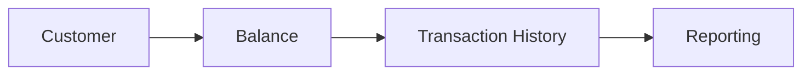
**Figure 2.1 - Traditional Banking Interaction Model**

## Future State
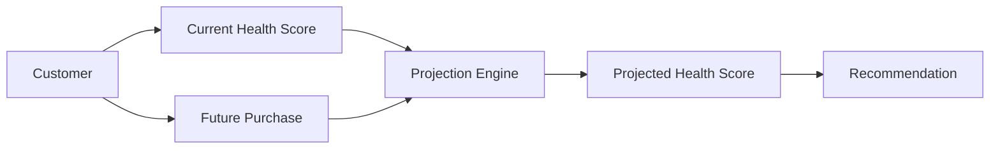
**Figure 2.2 - Financial Wellness Interaction Model**
# 3. Product Strategy

## Strategic Vision

The Financial Wellness Decision Engine (FWDE) aims to transform digital banking from a transactional service into a proactive financial wellness platform.

Traditional banking focuses on reporting historical information:

```text
What Have I Spent?
```

FWDE focuses on helping customers understand future outcomes:

```text
What Will Happen If I Spend?
```

The platform introduces a new decision-support paradigm:

```text
Current Financial Health

+

Future Financial Event

=

Projected Financial Health
```

This capability enables customers and financial institutions to evaluate the impact of spending decisions before or immediately after they occur.

---

## Strategic Objectives

### Customer Objectives

#### Financial Awareness

Provide visibility into:

- Current financial health
- Future financial impact
- Commitment coverage
- Savings impact
- Liquidity impact

#### Financial Confidence

Enable customers to make more informed decisions regarding:

- Large purchases
- Travel expenditure
- Savings withdrawals
- Lifestyle spending
- Borrowing decisions

#### Financial Wellbeing

Reduce:

- Unplanned overdrafts
- Missed direct debits
- Financial stress indicators
- Savings erosion

---

### Banking Objectives

#### Customer Engagement

Increase:

- Mobile app engagement
- Product interaction
- Financial wellness conversations
- Customer retention

#### Risk Mitigation

Reduce:

- Missed payment events
- Financial distress indicators
- Customer support interventions
- Early delinquency risk

#### Platform Innovation

Establish a reusable wellness platform supporting:

- Mobile banking
- Real-time payment events
- Open Banking integrations
- Merchant ecosystems
- Future AI assistants

---

## Product Positioning

### Traditional Banking

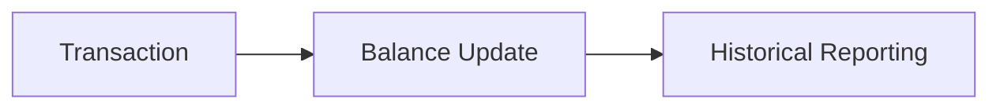

**Outcome:** Reactive customer experience.

---

### Financial Wellness Banking

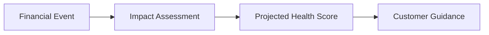

**Outcome:** Predictive customer experience.

---

## Product Portfolio

The Financial Wellness Decision Engine is structured around three progressive deployment models.

---

## Option 1 – Real-Time Payment Insights

### Objective

Provide financial wellness insights immediately after spending events.

### Trigger

```text
Card Purchase
```

### Process

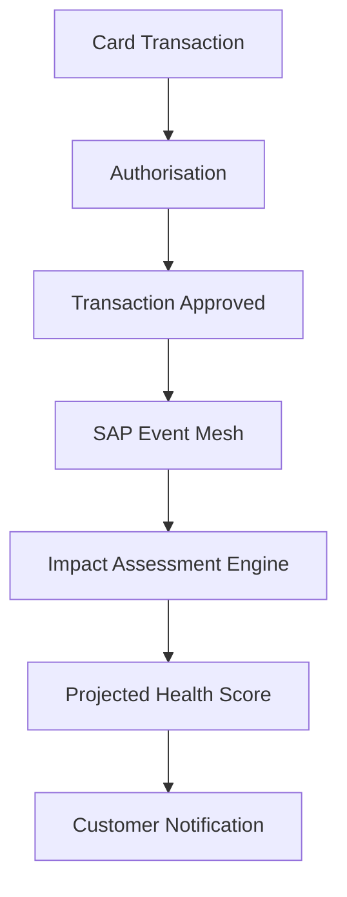

### Customer Outcome

```text
Financial Health Score

84 → 69

Recommendation:
Affordable With Caution
```

### Strategic Value

- High differentiation
- Event-driven banking experience
- Strong customer engagement
- Light-touch intervention model

---

## Option 2 – Banking Companion

### Objective

Allow customers to proactively assess affordability before spending.

### Trigger

```text
Customer Question

Can I Afford This?
```

### Process

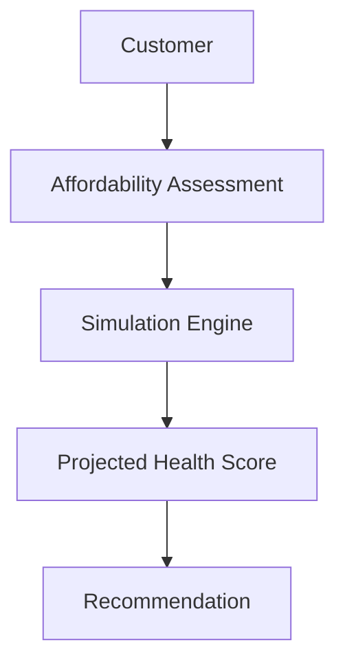

### Customer Outcome

Customers receive:

- Current Health Score
- Projected Health Score
- Liquidity Impact
- Savings Impact
- Commitment Coverage
- Recommendation

### Strategic Value

- Lowest implementation complexity
- Fastest route to market
- Ideal MVP
- Validates scoring model and projection logic

---

## Option 3 – Merchant Checkout Integration

### Objective

Provide financial wellness guidance directly within purchasing journeys.

### Trigger

```text
Merchant Checkout
```

### Process

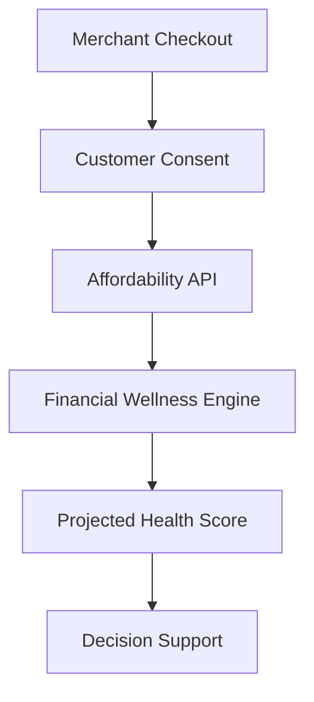

### Customer Outcome

Customers receive guidance before completing purchases.

### Strategic Value

- Creates ecosystem opportunities
- Supports Open Banking initiatives
- Enables embedded financial wellness
- Potential platform monetisation model

---

## Recommended Product Roadmap

The platform should be developed incrementally to reduce delivery risk and maximise learning.

### Phase 1 – Banking Companion

Duration:

```text
4 Weeks
```

Deliverables:

- Financial Health Score
- Projected Health Score
- RAP Services
- Mobile Dashboard
- Affordability Simulator

Primary Goal:

```text
Validate scoring model
```

---

### Phase 2 – Real-Time Payment Insights

Duration:

```text
4 Weeks
```

Deliverables:

- SAP Event Mesh Integration
- Purchase Impact Engine
- Real-Time Notifications
- Event-Based Processing

Primary Goal:

```text
Validate real-time engagement
```

---

### Phase 3 – Merchant Integration

Duration:

```text
6 Weeks
```

Deliverables:

- Affordability APIs
- Consent Framework
- Checkout Integration
- Open Banking Enablement

Primary Goal:

```text
Validate ecosystem value
```

---

### Phase 4 – AI Financial Coach

Deliverables:

- Goal Tracking
- Savings Coaching
- Spending Recommendations
- Subscription Optimisation
- Conversational Financial Wellness Assistant

Primary Goal:

```text
Create continuous financial wellness engagement
```

---

## Target Users

### Retail Banking Customers

Needs:

- Affordability assessment
- Financial planning
- Savings management
- Spending awareness

---

### Relationship Managers

Needs:

- Customer financial health insights
- Risk indicators
- Advice support tools

---

### Digital Banking Teams

Needs:

- Engagement services
- Wellness capabilities
- Differentiated product offerings

---

## Strategic Differentiators

| Capability | Traditional Banking Apps | FWDE |
|------------|-------------------------|------|
| Balance Reporting | ✓ | ✓ |
| Spending Categories | ✓ | ✓ |
| Budget Tracking | ✓ | ✓ |
| Cash Flow Forecasting | Partial | ✓ |
| Financial Health Score | Limited | ✓ |
| Projected Health Score | ✗ | ✓ |
| Real-Time Payment Impact | ✗ | ✓ |
| Merchant Checkout Wellness | ✗ | ✓ |
| Wellness-Focused AI | Limited | ✓ |

---

## Success Measures

### Customer Success

- Increased engagement
- Better financial decision making
- Reduced financial stress
- Improved savings behaviour

### Business Success

- Increased retention
- Reduced missed payment events
- Increased digital adoption
- Stronger customer relationships

### Technology Success

- RAP Services Operational
- Event-Driven Processing
- HANA Pushdown Analytics
- Explainable Scoring
- Mobile Integration

---

## Strategic Outcome

The Financial Wellness Decision Engine transforms digital banking from a system of record into a system of guidance.

Instead of answering:

```text
What happened?
```

the platform answers:

```text
What happens next?
```

This shift from historical reporting to projected financial wellbeing establishes the foundation for future AI-enabled financial coaching, proactive banking services, and customer financial wellness ecosystems.

# 4. Design Principles

## Explainable by Design

All recommendations must be traceable to calculations.

## Privacy by Design

Raw customer transaction data remains inside banking systems.

## Banking Native

Core functionality implemented using banking data assets.

## Event Driven

Real-time processing triggered by customer activity.

## AI Assisted

AI explains outcomes but never makes financial decisions.

## Composable

Reusable services exposed through APIs and RAP actions.

# 5. Market Analysis

The financial wellness market has evolved significantly over the last decade, with budgeting applications, digital banks, and fintech providers offering increasingly sophisticated spending and forecasting capabilities.

However, most solutions remain focused on historical reporting and budgeting rather than future-state financial wellbeing.

## Capability Comparison

| Capability | Typical Banks | Budgeting Apps | FWDE |
|------------|---------------|----------------|------|
| Balance Reporting | ✓ | ✓ | ✓ |
| Transaction Categorisation | ✓ | ✓ | ✓ |
| Spending Analysis | ✓ | ✓ | ✓ |
| Budget Management | Limited | ✓ | ✓ |
| Cashflow Forecasting | Limited | Partial | ✓ |
| Savings Goal Tracking | Limited | ✓ | ✓ |
| Financial Health Score | Rare | Partial | ✓ |
| Affordability Simulation | Rare | Limited | ✓ |
| Projected Financial Health Score | ✗ | ✗ | ✓ |
| Real-Time Payment Impact Analysis | ✗ | ✗ | ✓ |
| Merchant Checkout Guidance | ✗ | ✗ | ✓ |
| Event-Driven Financial Wellness | ✗ | ✗ | ✓ |
| AI Financial Coaching | Emerging | Partial | ✓ |

**Table 5.1:** Capability Comparison

---

## Market Gap

Existing banking applications primarily answer:
```text
What happened?
```

Examples:
- Current balance
- Historical spending
- Monthly budgets
- Category analysis

A smaller number of applications provide:

```text
What might happen?
```

Examples:

- Cashflow forecasting

- Savings goals

- Future balances

Very few applications answer:

```text
What happens to my financial health
if I complete this financial event?
```

This represents the primary market opportunity for the Financial Wellness Decision Engine.

---

## Strategic Positioning

FWDE is positioned between traditional digital banking and financial coaching.

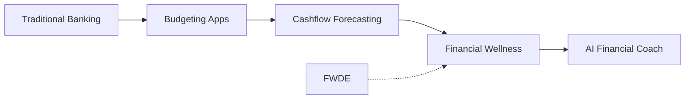

**Figure 5.1:** Strategic Market Positioning

---

## Competitive Challenge

Current market solutions typically focus on one area:

| Solution Type | Primary Focus |
|---------------|---------------|
| Digital Banks | Balances and transactions |
| Budgeting Apps | Spending control |
| Open Banking Providers | Data aggregation |
| Affordability APIs | Lending decisions |
| Financial Coaches | Behavioural guidance |

FWDE combines all of these disciplines into a single financial wellness platform.

---

## Key Differentiator

The primary differentiator of FWDE is the introduction of the:

### Projected Financial Health Score (PFHS)

```text
Current Financial Health

+

Financial Event

=

Projected Financial Health
```

Rather than measuring:

```text
What Has Happened?
```

FWDE measures:

```text
What Happens Next?
```
 
# 6. Core Concept
## Financial Wellness Decision Framework
`Current Financial Health`

`+`

`Financial Event`

`=`

`Projected Financial Health`

This becomes the central decisioning model used across all channels.
 
## Conceptual Architecture
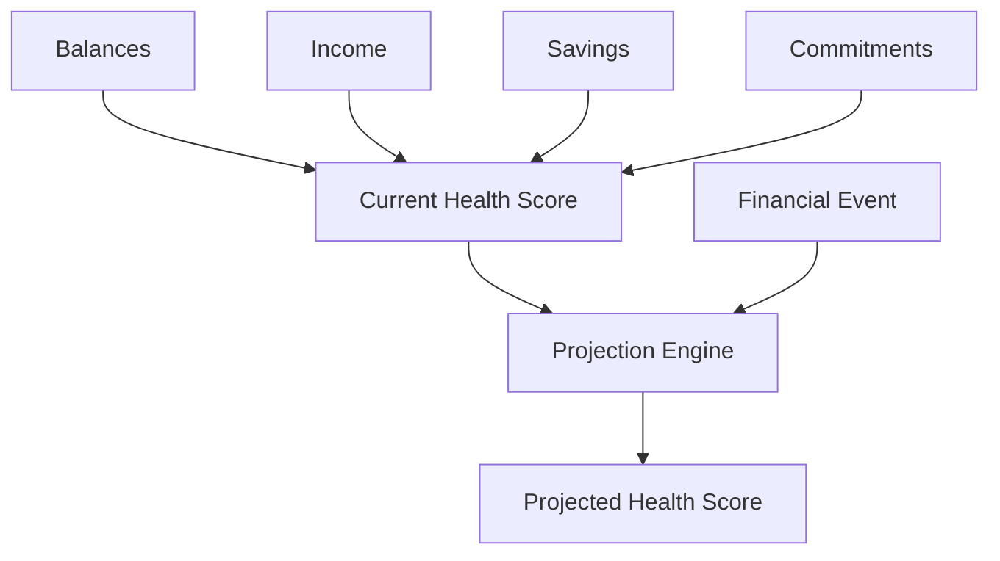
**Figure 6.1 - Projected Financial Health Engine**
 
# 7. Projected Financial Health Score (PFHS)

## Executive Definition

The Projected Financial Health Score (PFHS) is a future-state assessment of customer financial wellbeing following a proposed or completed financial event.

Unlike traditional financial scores that evaluate a customer's current position, PFHS evaluates how a financial event impacts future financial resilience, liquidity, commitment coverage, savings objectives, and overall financial wellness.

PFHS enables customers and financial institutions to evaluate:

- Can I afford this purchase?
- What impact will this purchase have?
- Will my future commitments remain covered?
- How does this affect my financial resilience?
- Does this delay my savings goals?

---

## Strategic Importance

The Projected Financial Health Score is the foundational innovation of the Financial Wellness Decision Engine.

Traditional banking focuses on:

- Current Balance
- Current Position
- Historical Spending

PFHS focuses on:

- Future Position
- Future Obligations
- Projected Financial Wellbeing

This shifts banking from a system of record to a system of guidance.

---

## Core Principle

```text
Current Financial Health + Financial Event = Projected Financial Health
```
---

## Conceptual Framework

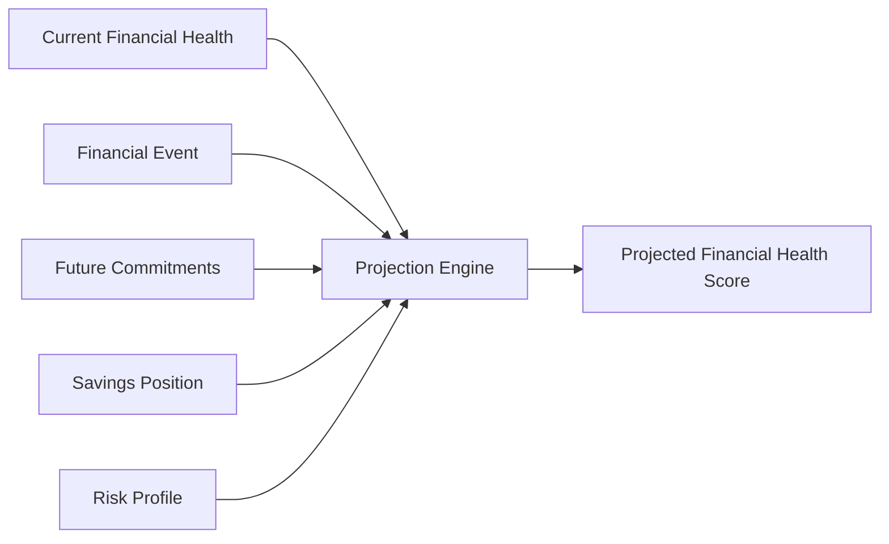

**Figure PFHS-1:** Projected Financial Health Framework

---

## Financial Events

PFHS may be triggered by multiple event types.

### Purchase Events

Examples:
- Holiday Booking
- Electronics
- Furniture
- Luxury Goods
- Automotive Purchase

---

### Savings Events

Examples:

- Savings Withdrawal
- ISA Withdrawal
- Investment Redemption

### Liability Events

Examples:
- Personal Loan
- Mortgage Increase
- Credit Limit Extension
- Buy Now Pay Later

### Banking Events
Examples:
- Direct Debit Failure
- Overdraft Entry
- Large Cash Withdrawal

## Strategic Differentiation

Most banking applications provide:

```text
Current Account Balance
```

Some provide:

```text
Cashflow Forecasting
```

Few provide:

```text
Projected Financial Health
```

The PFHS provides a measurable, explainable representation of future financial wellbeing and forms the foundation for proactive financial wellness banking.

 
# 8. Transaction Classification Framework
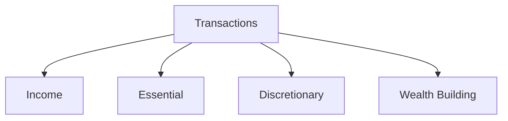
**Figure 8.1 - Transaction Classification Engine**
 
## Categories
### Income
- Salary
- Bonus
- Pension
- Dividend
### Essential
- Mortgage
- Rent
- Utilities
- Insurance
### Discretionary
- Travel
- Dining
- Entertainment
- Shopping
### Wealth Building
- Savings
- Investments
- Pension Contributions
  
# 9. SAP Target Architecture
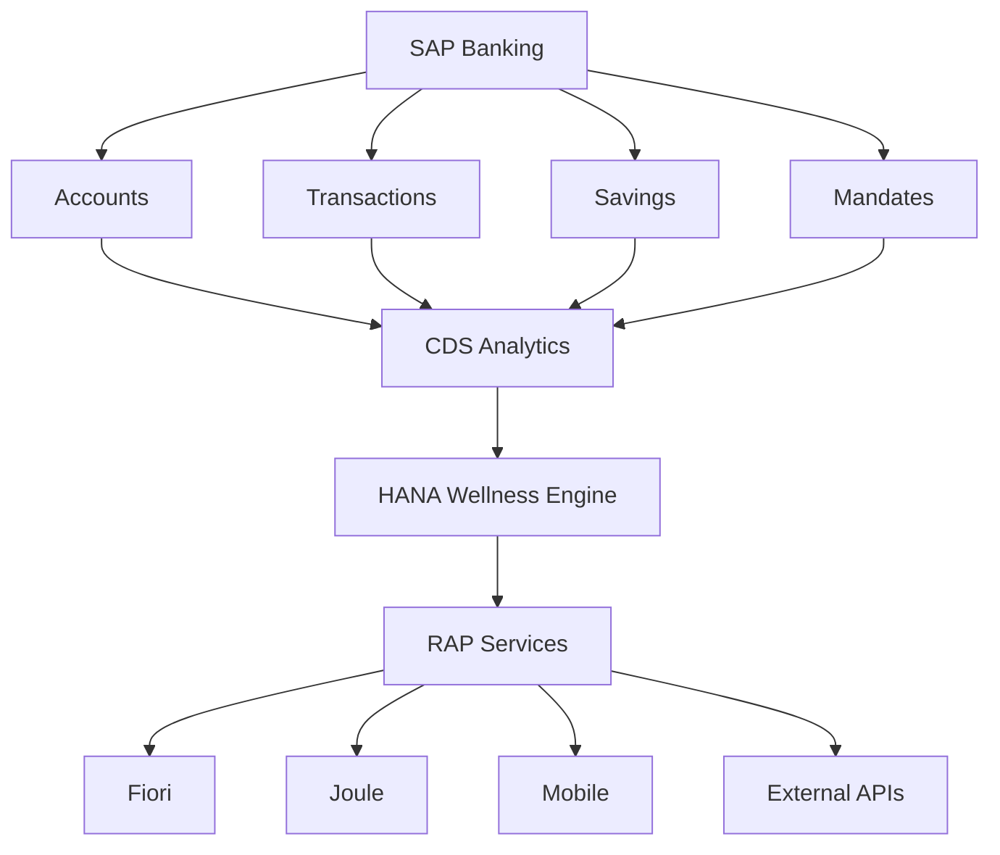
**Figure 9.1 - SAP Banking Architecture**

# 10. Event-Driven Architecture
## Option 1
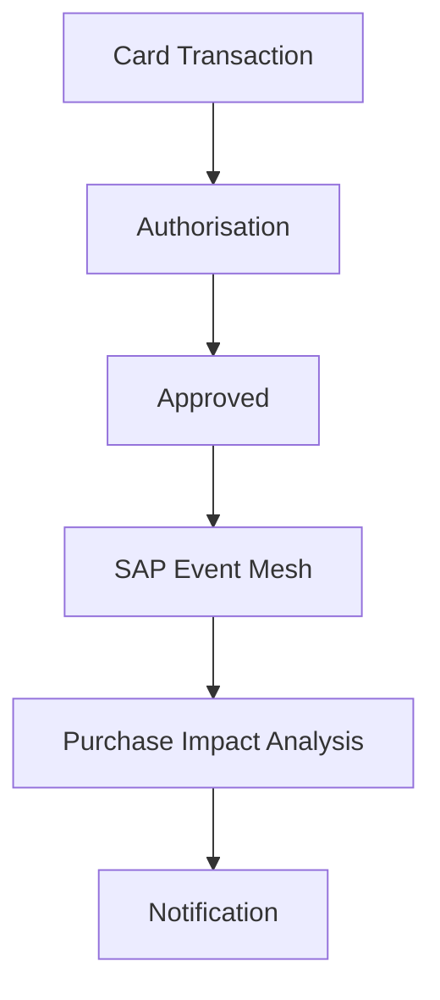
**Figure EDA-1 - Real-Time Financial Wellness Flow**
 
# 11. Merchant Integration Architecture
## Option 3
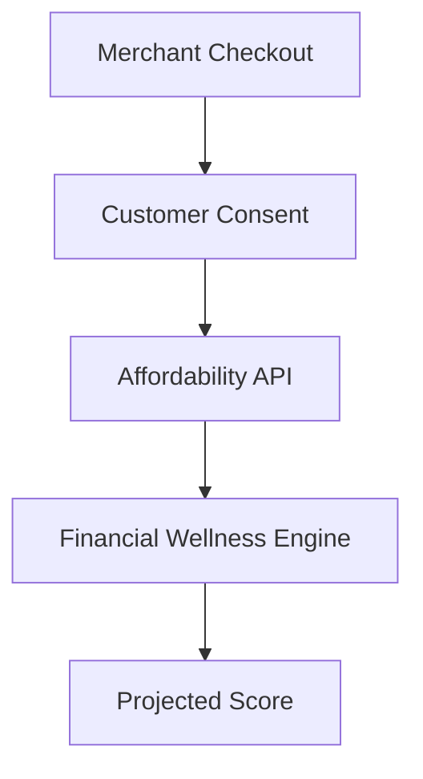
**Figure MCI-1 - Merchant Checkout Integration**
 
# 12. Governance & Responsible AI
## Principles
### Explainability
All recommendations must be explainable.
### Auditability
All calculations retained.
### Privacy
Raw banking data never exposed to GenAI services.
### Responsible AI
`AI Explains`

`AI Does Not Decide`
 
# 13. Delivery Roadmap
## Phase 1
### Banking Companion
Duration: 4 Weeks
Deliverables:
- Health Score Engine
- Projection Engine
- RAP Service
- Fiori Application
 
## Phase 2
### Real-Time Insights
Duration: 4 Weeks
Deliverables:
- Event Mesh
- Impact Engine
- Notifications
 
## Phase 3
### Merchant Integration
Duration: 6 Weeks
Deliverables:
- Open Banking Integration
- Merchant APIs
- Checkout Experience

# 14. Business Value

## Executive Overview

The Financial Wellness Decision Engine (FWDE) creates value by helping financial institutions improve customer engagement, reduce financial distress indicators, and establish differentiated digital banking experiences.

The platform enables a strategic shift from transactional banking to proactive financial wellness guidance.

---

## Customer Value

FWDE helps customers:

- Make better financial decisions
- Understand affordability before spending
- Reduce financial stress
- Improve savings behaviour
- Protect future financial resilience

Traditional banking tells customers:

```text
What happened?
```

FWDE helps customers understand:

```text
What happens next?
```

---

## Revenue Opportunities

### Premium Financial Wellness Services

Banks could introduce subscription-based services including:

- Advanced affordability assessment
- Financial coaching
- Goal tracking
- Spending simulations

### Merchant Partnerships

FWDE creates opportunities for:

- Point-of-sale wellness checks
- Merchant referral partnerships
- Embedded finance journeys

### Open Banking Services

The affordability engine can be exposed through APIs to:

- Merchants
- Lending providers
- Third-party fintechs

---

## Cost Reduction Opportunities

### Reduced Customer Support

Better decision-making may reduce:

- Overdraft-related enquiries
- Financial hardship support requests
- Payment failure investigations

### Reduced Credit Risk

Improved affordability awareness may reduce:

- Missed payments
- Direct debit failures
- Early-stage delinquency indicators

### Improved Operational Efficiency

Real-time wellness assessments provide automated guidance that reduces manual intervention.

---

## Customer Retention

The platform creates differentiated experiences through:

- Personalised insights
- Affordability assessments
- Financial coaching
- Future-state financial planning

This increases customer engagement and reduces switching risk.

---

## Competitive Differentiation

Most digital banks offer:

- Balance reporting
- Spending analysis
- Budget tracking

FWDE introduces:

- Projected Financial Health Score
- Real-Time Wellness Assessment
- Financial Event Impact Analysis

This creates a distinctive market position.

---

## Strategic AI Readiness

FWDE establishes a structured financial wellness model that can be leveraged by future AI assistants.

Potential future capabilities include:

- Personal financial coaching
- Goal achievement recommendations
- Financial resilience monitoring
- Behavioural spending guidance

The platform therefore acts as a foundation for future AI-enabled banking products.

---

## Strategic Outcome

FWDE enables financial institutions to move from:

```text
Transaction Processing
```

to

```text
Financial Guidance
```

creating measurable value for customers, product teams, and financial institutions while establishing a foundation for future AI-driven banking services.

 
# 15. Conclusion
The Financial Wellness Decision Engine introduces a new category of digital banking capability based around:

## Projected Financial Health Score (PFHS)
Rather than analysing what customers have already spent, the platform predicts financial wellbeing following future financial events and provides actionable, explainable guidance.
This creates a foundation for:
- Real-time spending intelligence
- Digital financial coaching
- Affordability decision support
- AI-assisted financial wellness services
- Next-generation banking experiences
 
# Appendix A – Innovation Register

## Purpose

The Innovation Register documents the core concepts, frameworks, and analytical models proposed by the Financial Wellness Decision Engine (FWDE).

This register establishes a formal record of the concepts contained within this repository and serves as a foundation for future product development, innovation review, patent assessment, and architectural governance.

---

# Potentially Novel Concepts

## Projected Financial Health Score (PFHS)

### Definition

A future-state measure of customer financial wellbeing calculated by assessing the projected impact of financial events on financial resilience, commitment coverage, savings position, and overall wellness.

### Core Principle

```text
Current Financial Health

+

Financial Event

=

Projected Financial Health
```

### Strategic Value

Moves banking from historical reporting to future-state decision support.

---

## Financial Event Impact Engine (FEIE)

### Definition

A specialised analytics engine responsible for quantifying the effect of a financial event on a customer's future financial wellbeing.

### Event Types

```text
Purchases

Savings Withdrawals

Loans

Direct Debit Failures

Large Transfers
```

### Outputs

```text
Score Delta

Liquidity Impact

Risk Classification

Recommendation
```

---

## Banking Native Wellness Graph

### Definition

A structured representation of customer financial wellbeing created using interconnected financial wellness indicators.

### Components

```text
Income

Liquidity

Commitments

Savings

Spending Behaviour

Risk Profile
```

### Purpose

Provides a reusable foundation for:

```text
Health Score

Projected Score

AI Coaching

Personalisation
```

---

## Health Score Delta Model

### Definition
A methodology for quantifying changes in financial wellbeing resulting from financial events.

### Purpose

Standardises financial impact evaluation.

---

## Real-Time Wellness Assessment

### Definition

An event-driven approach where financial wellness analysis is triggered immediately following a payment or financial event.

### Flow

```text
Transaction

↓

Event

↓

Impact Assessment

↓

Projected Health Score

↓

Notification
```

### Strategic Value

Creates contextual financial guidance at the moment of customer decision making.

---

## Safe Spending Buffer

### Definition

The available discretionary spending capacity after accounting for expected income, future commitments, and a minimum emergency reserve.

A measure of discretionary spending capacity used within affordability assessments.

## Financial Wellness Decision Engine (FWDE)

### Definition

A banking-native platform designed to evaluate current and projected customer financial wellbeing.

### Core Capabilities

```text
Health Score

Projected Health Score

Affordability Assessment

Purchase Simulation

Financial Wellness Guidance
```

### Strategic Positioning

Transforms digital banking from:

```text
System of Record
```

to:

```text
System of Guidance
```

---

# Future Research Opportunities

Potential future investigations include:

- Goal-based financial planning
- Predictive financial hardship analysis
- AI-generated coaching recommendations
- Merchant ecosystem integration
- Open Banking wellness services
- Real-time financial resilience monitoring

---

# Strategic Summary

The Projected Financial Health Score, Financial Event Impact Engine, Banking Native Wellness Graph, Health Score Delta Model, and Real-Time Wellness Assessment collectively form the foundational innovation framework of the Financial Wellness Decision Engine.

Together these concepts establish a future-state financial wellness platform that extends beyond budgeting, forecasting, and affordability checks into proactive customer financial guidance.

## Appendix B - Authorship Record

**Document Title:** Financial Wellness Decision Engine™

**Version:** 1.0

**Author:** Narin Nandivada

**Created:** 19 November 2026

**Purpose:** Innovation concept paper documenting the Financial Wellness Decision Engine architecture, financial wellness frameworks, and projected financial health methodologies.

### Key Concepts Documented

- Projected Financial Health Score (PFHS)™
- Financial Event Impact Engine (FEIE)™
- Health Score Delta Modelling
- Banking Native Financial Wellness Graph
- Real-Time Post-Authorisation Wellness Assessment

### Authorship Statement

This document represents original work authored by Narin Nandivada and serves as a dated record of the concepts, frameworks, and architectural approaches described herein.

**End of Document**
