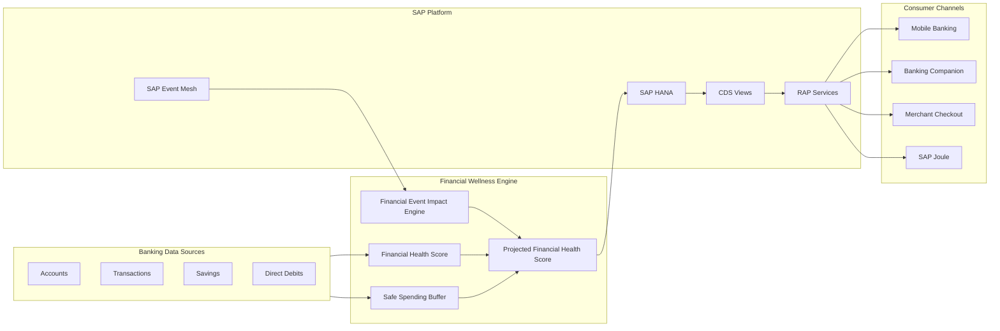

# Financial Wellness Decision Engine (FWDE)

## Overview

The Financial Wellness Decision Engine (FWDE) is a conceptual banking platform designed to help financial institutions move beyond historical transaction reporting and towards proactive financial wellness guidance.

Traditional banking applications primarily answer:

> What happened?

FWDE introduces a future-state decision framework that helps answer:

> What happens next?

The platform combines financial health scoring, affordability assessment, financial event impact modelling, and real-time decision support to provide customers and financial institutions with greater visibility into projected financial wellbeing.

---

## Conceptual Architecture


### Decision Framework

The Financial Wellness Decision Engine is built around a simple principle:

```text
Current Financial Health
+
Financial Event
=
Projected Financial Health
```

Rather than focusing solely on historical spending, the platform evaluates the potential impact of financial events on future financial wellbeing and affordability.

## Key Innovation

### Projected Financial Health Score (PFHS)

The central concept introduced within this repository is the **Projected Financial Health Score (PFHS)**.

PFHS extends traditional financial health measurement by evaluating the projected impact of future or recent financial events on a customer's overall financial wellbeing.

```text
Current Financial Health
+
Financial Event
=
Projected Financial Health
```

This enables customers to understand:

- Can I afford this purchase?
- How will this affect my future financial position?
- Will upcoming commitments remain covered?
- How will this affect savings and liquidity?

---

## Core Concepts

The FWDE framework introduces several interconnected concepts:

- Projected Financial Health Score (PFHS)
- Financial Event Impact Engine (FEIE)
- Health Score Delta Model
- Banking Native Wellness Graph
- Real-Time Wellness Assessment
- Safe Spending Buffer

Together these concepts form a financial wellness decision-support framework that extends beyond budgeting, forecasting, and traditional affordability checks.

---

## Example Use Cases

### Banking Companion

Allows customers to simulate purchases before spending and understand the impact on future financial wellbeing.

### Real-Time Payment Insights

Provides contextual financial wellness assessments immediately after payment events.

### Merchant Checkout Integration

Enables affordability assessment and financial wellness guidance directly within purchasing journeys.

### AI Financial Coaching

Provides a foundation for future conversational financial wellness assistants and proactive guidance services.

---

## Architecture Overview

FWDE is designed as a banking-native financial wellness platform that combines:

- Financial health assessment
- Projected financial wellbeing modelling
- Event-driven customer insights
- Affordability guidance
- Open banking and ecosystem integration
- AI-assisted financial coaching

The solution is intended to leverage modern SAP and digital banking technologies while remaining implementation-agnostic in this public edition.

## Repository Contents

## Read the Full Concept Paper

📄 [Financial Wellness Decision Engine v1.0](Financial_Wellness_Decision_Engine_Public_v1.0.md)

| Document | Description |
|-----------|-------------|
| Financial_Wellness_Decision_Engine_v1.0.md | Full concept paper |
| Appendix A | Innovation Register |
| Appendix B | Sample Calculations |
| Appendix C | SAP Object Inventory |
| Appendix D | Authorship Record |

---

## Important Notice

This repository presents conceptual frameworks, methodologies, architectures, and illustrative examples intended for innovation, research, architectural review, and professional portfolio purposes.

The scoring models, calculations, examples, and recommendations are illustrative and should not be interpreted as:

- Financial advice
- Production-ready banking algorithms
- Regulatory guidance
- Credit risk models
- Validated affordability methodologies

Any production implementation would require calibration, validation, regulatory review, and real-world testing.

---

## Intellectual Property

Copyright © 2026 Narin Nandivada.

This repository documents original concepts, frameworks, methodologies, scoring models, architectural approaches, and product designs associated with the Financial Wellness Decision Engine (FWDE).

See the Intellectual Property Notice, Innovation Register, and Authorship Record within the concept paper for further details.

---

## Author

**Narin Nandivada**

SAP S/4HANA Engineering Lead | Enterprise Architect | Innovation & Digital Transformation

---

## Status

**Version:** 1.0

**Type:** Innovation Concept Paper

**Domain:** Digital Banking, Financial Wellness, Enterprise Architecture, SAP Banking

---

## Disclaimer

The concepts and frameworks described in this repository represent independent research and innovation work authored by Narin Nandivada.

This repository is intended to stimulate discussion around proactive financial wellness, affordability assessment, explainable analytics, and future-state banking experiences.
